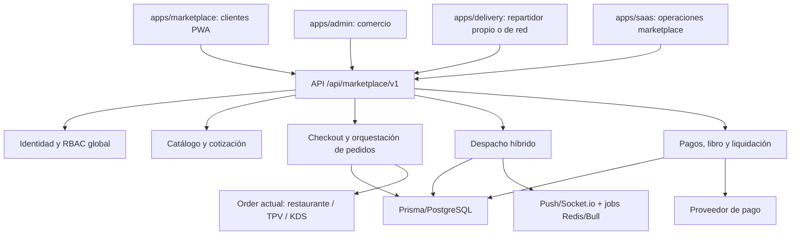

# MRTPVREST Marketplace — Documento de arquitectura técnica v1.0

**Fecha:** 22 de octubre de 2026  
**Alcance:** Marketplace multicomercio con reparto híbrido: repartidores del negocio y repartidores independientes de la plataforma.  
**Estado:** propuesta de arquitectura, basada en revisión de código; **no implementada ni desplegada**.

## 0. Resumen ejecutivo y decisiones

- **No reemplazar el TPV, el KDS ni las tiendas actuales.** Construir una capa de comercio y logística transversal.
- **Stack:** monorepo PNPM/Turbo existente; nuevo `apps/marketplace` (Next.js/PWA); ampliar `apps/backend` (Express), `apps/delivery` (Next.js + Capacitor), `apps/admin`, `apps/saas`, `packages/database` (Prisma/PostgreSQL).
- **Pedido MVP:** un comercio/sucursal por checkout y por `MarketplaceOrder`. Carrito de múltiples negocios se posterga; si se agrega, dividir en subórdenes por comercio, evitando asumir un split de pago 1:N.
- **Modo logístico del negocio:** `OWN_ONLY`, `SHARED_ONLY`, `OWN_THEN_SHARED`, `MANUAL`. Por pedido: `OWN` o `SHARED` y conmutación autorizada antes de la recogida.
- **Drivers:** no usar `Employee.id` como identidad global. `Courier` / `CourierProfile` es identidad de plataforma; `MerchantCourierLink` relaciona repartidores propios con `Employee` opcionalmente. Pedidos legacy siguen usando `Order.deliveryDriverId`; los del marketplace llevan `DeliveryTask` y `DeliveryAssignment`, y el enlace a `Employee` solo cuando corresponde a reparto propio.
- **Seguridad:** conservar aislamiento por `restaurantId` en operaciones locales; endpoints globales específicos con políticas de autorización, nunca bypass amplio ni confiar en IDs enviados por cliente.
- **Dinero:** `Decimal(12,2)`, snapshots de precios y comisiones, conciliación y libro de movimientos; no copiar `Float` de tablas históricas al nuevo dominio.
- **Objetivo de lanzamiento:** piloto restringido, monitoreado y con reversión por feature flags.

## 1. Inventario técnico revisado

Repositorio `colonmbiano/mrtpvrest`, rama `master` (lectura de código realizada el 22/10/2026):

| Código | Comportamiento confirmado / restricción |
|---|---|
| `packages/database/prisma/schema.prisma` | 143 modelos; `Tenant -> Restaurant -> Location`; `User` tiene `restaurantId`; `Customer` único `(restaurantId,phone)`; `Order` requiere `restaurantId`, tiene `source` String, `deliveryDriverId` String? y subtotal/envío/total en Float; `RestaurantConfig` guarda modalidades de envío y origen; `DeliveryZone` tiene polígonos por restaurante. |
| `apps/backend/src/routes/store.routes.js` | `POST /api/store/orders` crea órdenes del comercio, recalcula ítems/totales en backend y notifica TPV/KDS; `POST /api/store/payment/create` inicia checkout individual; el webhook Mercado Pago lee primero una integración disponible para determinar la orden: diseñar uno independiente y seguro para marketplace. |
| `apps/backend/src/routes/delivery.routes.js` | Repartidor tratado como `Employee` con rol DELIVERY, asociado a sucursal; `/available-orders`, `/:driverId/claim/:orderId`, `/assign`, `/unassign`; `claim` pasa a `ON_THE_WAY` al tomar pedido, incompatible con el ciclo separado de ofertas/pickup de la plataforma. |
| `apps/backend/src/routes/gps.routes.js` | `DriverLocation` y `DriverRoute` existentes, pero `getOrigin()` usa variables de entorno globales; el GPS de plataforma necesita origen por sucursal. |
| `apps/delivery/src/components/delivery/GPSTracker.tsx` | GPS por `navigator.geolocation` + intervalos de 60 s y aviso de mantener app abierta: no prometer tracking de fondo fiable con la PWA actual. |
| `apps/backend/src/services/notifications.service.js` | Web push y Socket.io existentes con identidad `driver:<Employee.id>`, hoy publicados por restaurante/sucursal. Añadir destinatarios/rooms para identidad `Courier` global. |
| `apps/backend/src/middleware/tenant.middleware.js` | Rutas regulares requieren resolver restaurante; añadir API global con auth/aislamiento específicos, no un acceso indiscriminado al backend. |
| `packages/database/tenant-guard.js` | Guard Prisma `SCOPED_MODELS` para tablas con `restaurantId`; los modelos nuevos con ese campo deben añadirse. |
| `apps/backend/src/routes/payments.routes.js` | Pago individual Mercado Pago + verificación de firma en una ruta. No reutilizar sin endurecer permisos y adaptar distribución, ciclo de pedido e idempotencia. |
| `apps/backend/package.json` | Express 4, Prisma 7, Bull 4, Socket.io, Mercado Pago, Stripe, Zod, PostgreSQL/Supabase. |

**Precisión:** se verificó código, no se ejecutó la aplicación ni una consulta en la base de datos productiva. El estado de despliegue y la versión real de datos/migraciones deben confirmarse antes de modificar producción.

## 2. Arquitectura de componentes



### Estructura sugerida

```text
apps/marketplace/                  # Nuevo frontend Next.js / PWA
apps/backend/src/routes/marketplace/
  public.routes.js                # Búsqueda pública de comercios/catálogos
  auth.routes.js                  # Clientes/repartidores de plataforma
  orders.routes.js                # Cotizar, ordenar, consultar
  merchant.routes.js              # Afiliación y operación comercial
  courier.routes.js               # Disponibilidad, ofertas, GPS, POD
  dispatch.routes.js              # Propios, red y reasignación
  payments.routes.js              # Checkout, estado, webhooks
  admin.routes.js                 # Moderación y operación global
apps/backend/src/services/marketplace/
  catalog.service.js
  quote.service.js
  order-orchestrator.service.js
  dispatch.service.js
  delivery-pricing.service.js
  courier-matching.service.js
  payments.service.js
  ledger.service.js
  settlement.service.js
  notification-outbox.service.js
packages/database/prisma/migrations/<timestamp>_marketplace_core/
apps/backend/__tests__/marketplace/
```

No duplicar el catálogo físico: `MenuItem` mantiene su propiedad por restaurante, el Marketplace solo tiene su estado de publicación (`MarketplaceListing`). Para retail, diseñar un adaptador `RetailSku` en otra fase sin usar `OrderItem.menuItemId` ficticios.

## 3. Dominio y esquema de datos propuesto

Usar nombres definitivos en singular Prisma y tabla `marketplace_*`. Todo importe monetario nuevo `Decimal @db.Decimal(12,2)` y snapshots inmutables. Todas las referencias a entidades existentes tienen FK real cuando sea viable. Para claves de identidad global se exige verificación de correo/teléfono, consentimiento de privacidad y mecanismo de recuperación.

### Tablas esenciales (MVP)

| Modelo | Campos mínimos | Invariantes / índices |
|---|---|---|
| `MarketplaceAccount` | id, email?, phone?, passwordHash?, verifiedAt, status, createdAt | email/phone normalizados únicos cuando no sean nulos; distinguir CUSTOMER / COURIER por membresías y no por JWT editable |
| `MarketplaceAddress` | id, accountId, label, street, neighborhood, references, lat, lng, geoStatus | acceso solo por dueño; cifrar/proteger dirección sensible |
| `MarketplaceMerchant` | id, restaurantId, locationId, slug, category, status, deliveryPolicy, commissionBps, payoutConfig | `@@unique([locationId])`, índice status/categoría; negocio puede estar en varias sucursales con fichas distintas |
| `MarketplaceMerchantMember` | id, merchantId, accountId?, userId?, role | autorización por pertenencia/rol; un dueño existente puede usar su sesión verificada |
| `MarketplaceListing` | id, merchantId, menuItemId?, retailSkuId?, published, position | asociación al catálogo real; FK verificada al mismo restaurante, un tipo de producto por fila |
| `MarketplaceCourier` | id, accountId, status, verificationStatus, vehicleType, maxActiveTasks, createdAt | `accountId UNIQUE`; no pertenece a un tenant; no exposición pública de documentos |
| `MarketplaceCourierAffiliation` | id, courierId, merchantId, employeeId?, status, canTakeOwnOrders | `@@unique([courierId,merchantId])`; si Employee no está vinculado a ese restaurante, denegar |
| `MarketplaceCourierPresence` | courierId, isOnline, acceptingShared, lat, lng, accuracy, lastSeenAt, expiresAt | presencia caduca; GPS para matching, no para acceso a datos de otros pedidos |
| `MarketplaceOrder` | id, accountId, merchantId, restaurantId, locationId, orderId, quoteId, fulfillmentType, dispatchMode, status, subtotal, deliveryFee, tip, discount, total, commissionBps, commissionAmount, courierPayoutAmount, currency, createdAt | `orderId UNIQUE`, snapshots `Decimal`, `clientRequestId UNIQUE` por cuenta, `restaurantId` solo del comercio elegido |
| `MarketplaceQuote` | id, accountId, merchantId, itemsSnapshot, priceSnapshot, deliveryPrice, expiresAt, status | tarifa calculada servidor; TTL p.ej. 5 min; nunca confiar en montos del navegador |
| `DeliveryTask` | id, marketplaceOrderId, merchantId, pickupLat/Lng, dropoffLat/Lng, status, dispatchMode, readyAt, currentAssignmentId?, attempts | `marketplaceOrderId UNIQUE`; `currentAssignmentId` apunta a asignación válida |
| `DeliveryOffer` | id, deliveryTaskId, courierId, payoutOffer, expiresAt, status | `@@unique([deliveryTaskId,courierId,attempt])`; caducidad y reintentos |
| `DeliveryAssignment` | id, taskId, courierId, affiliationId?, source, status, acceptedAt, pickedUpAt, deliveredAt, proofCodeHash? | una sola asignación activa por tarea (índice parcial SQL + transacción atómica); retener historial de cambios |
| `MarketplacePayment` | id, marketplaceOrderId, provider, providerPaymentId?, status, amount, currency, attemptNo, receivedAt | `providerPaymentId UNIQUE` cuando no nulo; firmas, montos y referencias verificadas |
| `MarketplaceLedgerEntry` | id, eventKey, marketplaceOrderId, accountType, accountId, debit, credit, currency, postedAt | entradas inmutables e idempotentes; conciliación por evento |
| `MarketplaceSettlement` | id, beneficiaryType, beneficiaryId, periodStart, periodEnd, amount, status, externalTransferId?, paidAt | evitar doble liquidación con clave externa y transiciones controladas |
| `MarketplaceWebhookEvent` | id, provider, eventId, bodyHash, status, receivedAt, processedAt | `@@unique([provider,eventId])` + procesamiento seguro con reintentos |
| `MarketplaceOutboxEvent` | id, aggregateType, aggregateId, eventType, payload, status, attempts, nextRunAt | inserción transaccional; workers para push/webhook/notificaciones |

**Adiciones a modelos existentes:** `Order.source = 'MARKETPLACE'` (campo String, no requiere enum nuevo); relación por `MarketplaceOrder.orderId`; no poblar `Order.userId` con un `MarketplaceAccount` ajeno. `Location` mantiene su estructura; agregar ubicación GPS por sucursal o tabla `MerchantPickupPoint` georreferenciada con lat/lng verificadas. Agregar relaciones inversas Prisma mediante migraciones aditivas.

**Prisma esquemático ilustrativo (no pegar sin integrar relaciones inversas y migración):**

```prisma
enum MarketplaceDispatchMode { OWN SHARED }
enum MarketplaceTaskStatus {
  WAITING_READY OFFERING ASSIGNED PICKED_UP DELIVERED
  REASSIGNING FAILED CANCELLED
}

model MarketplaceOrder {
  id             String   @id @default(cuid())
  accountId      String
  merchantId     String
  restaurantId   String
  locationId     String
  orderId        String   @unique
  clientRequestId String @unique
  dispatchMode   MarketplaceDispatchMode
  subtotal       Decimal  @db.Decimal(12, 2)
  deliveryFee    Decimal  @db.Decimal(12, 2)
  discount       Decimal  @default(0) @db.Decimal(12, 2)
  tip            Decimal  @default(0) @db.Decimal(12, 2)
  commissionBps  Int
  commissionAmount Decimal @db.Decimal(12, 2)
  courierPayoutAmount Decimal @db.Decimal(12, 2)
  total          Decimal  @db.Decimal(12, 2)
  currency       String   @default("MXN")
  status         String   @default("PENDING_PAYMENT")
  createdAt      DateTime @default(now())
  updatedAt      DateTime @updatedAt
  @@index([restaurantId, status, createdAt])
  @@index([merchantId, createdAt])
}

model DeliveryOffer {
  id           String   @id @default(cuid())
  taskId       String
  courierId    String
  attempt      Int
  payoutAmount Decimal  @db.Decimal(12, 2)
  status       String   @default("OFFERED")
  expiresAt    DateTime
  createdAt    DateTime @default(now())
  @@unique([taskId, courierId, attempt])
  @@index([courierId, status, expiresAt])
}
```

**Nota de guard:** cada modelo nuevo con `restaurantId` entra en `SCOPED_MODELS` y tests correspondientes. Las consultas globales al catálogo solo pueden ver campos públicos de comercios inscritos, con verificación `published/status` y scope explícito. No agregar a la API pública libre acceso SQL a `Order`, `Customer`, `Employee` o `Courier`.

## 4. Reparto híbrido: reglas exactas

### Política por comercio

- `OWN_ONLY`: su personal atiende exclusivamente ese comercio.
- `SHARED_ONLY`: los pedidos entran al pool de repartidores de plataforma.
- `OWN_THEN_SHARED`: se ofrece primero al personal propio durante un tiempo configurable; después se solicita red compartida.
- `MANUAL`: el operador decide para cada pedido.
- `fallbackSeconds` y `maxDistanceKm` configurables por sucursal.
- Un courier puede estar afiliado a un comercio y habilitado para la red; cada aceptación se guarda con `source = OWN | SHARED`, contrato económico y condiciones específicas. No se suman encargos incompatibles en paralelo.

### Máquina de estados

```text
Pedido: PENDING_PAYMENT -> PENDING_MERCHANT -> ACCEPTED -> PREPARING
        -> READY -> ON_THE_WAY -> DELIVERED
        ramas: CANCELLED / REFUND_PENDING / REFUNDED / DISPUTED

DeliveryTask: WAITING_READY -> OFFERING -> ASSIGNED -> PICKED_UP -> DELIVERED
              ramas: REASSIGNING -> OFFERING; FAILED / CANCELLED
DeliveryOffer: OFFERED -> ACCEPTED | DECLINED | EXPIRED
```

`Order.status = ON_THE_WAY` **solo después de pickup**, no cuando la oferta fue aceptada. Si el negocio cancela después de que el courier aceptó, aplicar matriz de compensaciones. Para envíos incompletos/dirección equivocada, `FAILED` y resolución humana; nunca marcar `DELIVERED` sin evidencia.

### Asignación y simultaneidad

1. Merchant acepta el pedido y define ETA real de preparación.
2. Según `deliveryPolicy` busca couriers propios disponibles o independientes dentro de radio/tiempo válidos.
3. Se calcula costo y pago ofertado **antes** de enviar oferta; ranking por ETA, carga, distancia en red vial, actividad y reglas de imparcialidad.
4. `DeliveryOffer` vence en 15–30 segundos (valor piloto configurable), pasa a siguiente ola/fallback sin asumir aceptación.
5. La aceptación usa transacción y `UPDATE ... WHERE status = 'OFFERING'` del `DeliveryTask` para reservar un solo ganador. Emplear índice único parcial para una asignación activa por task, en migración SQL, más test de concurrencia.
6. No marcar el pedido en camino antes del escaneo/código de recogida o confirmación equivalente.
7. Si falla el reparto: reasignar conservando historial y tarifa aprobada o solicitar intervención. Nunca permitir dos repartidores cobrando la misma entrega.
8. Eventos `TaskAssigned`, `CourierArrived`, `PickedUp`, `Delivered` se publican desde outbox después del commit.

### GPS y privacidad

- Migrar el origen de `gps.routes.js` desde `RESTAURANT_LAT/LNG` global a la sucursal del pedido.
- Presencia con lat/lng, precisión, última señal y vigencia. No ofrecer a courier con ubicación obsoleta (p.ej. >90 s, configurable).
- Tracking a clientes solo de la tarea aceptada, nunca la ubicación libre completa del courier ni domicilios de otros clientes.
- PWA opera foreground; para GPS de fondo fiable, validar un módulo Android Capacitor nativo, permisos, foreground service, consumo de batería y políticas de publicación.
- Límites de retención: ubicación detallada corta; evidencia/ledger se conserva según obligaciones y necesidades documentadas.

## 5. Catálogo, precios y checkout

### Discover / catálogo

- `MarketplaceMerchant` referencia a `Restaurant` y `Location` reales; un comercio con tres sucursales puede tener tres entradas con la misma marca y distintas zonas/horarios.
- `MarketplaceListing` referencia `MenuItem` (primera fase) y su `availableOnline`; no copiar y desacoplar precios permanentemente. Categoría pública configurable.
- Búsqueda por ubicación/radio, horario, disponibilidad, categoría y ETA. Índices geoespaciales o geoceldas según la necesidad real; MVP puede usar bounding box + Haversine backend y paginación limitada.
- No mostrar un negocio suspendido ni publicar restaurante sin habilitación expresa. No depender del plan SaaS para elegibilidad a la red: crear entitlement separado `MARKETPLACE_ONLY` o acceso `MARKETPLACE` de producto, con política clara de expiración.

### Cotización y orden

1. `POST /quotes` recibe merchantId, items (IDs/cantidades/modificadores), tipo entrega y ubicación; servidor valida propiedad del catálogo, horario, capacidad, cobertura y promociones; retorna TTL y desglose firmado/persistido.
2. `POST /orders` recibe quoteId, dirección guardada, método pago, `Idempotency-Key`; en **una transacción** crea `Order` de restaurante y `MarketplaceOrder`, reserva cupón si aplica y escribe outbox. `Order.source='MARKETPLACE'`, `locationId` de la tienda real, monto calculado servidor.
3. TPV/KDS reciben notificación por rooms existentes (`restaurant:<id>:location:<id>`), pero el cliente consulta orden global por su identidad, no por ID del restaurante.
4. Checkout permite solo un merchant por pedido inicial. Si falla el pago, reintento mediante nueva `MarketplacePayment` y misma orden; no duplicar pedido ni inventario.
5. Cobertura y envío del Marketplace son específicos por comercio/sucursal; la función actual `computeDeliveryFee` es útil como base pero no garantiza tarifa carretera ni pago de courier. Crear cotizador diferenciado y snapshot.

### Idempotencia

- Llaves `clientRequestId` únicas en DB por operación de checkout.
- Provider payment ID único (no dos órdenes para un mismo cobro).
- Webhook `eventId` único por proveedor.
- `DeliveryTask` único por orden Marketplace.
- Una asignación activa por task (índice parcial SQL + transición CAS).
- Una entrada de ledger por `eventKey` y concepto; settlement sin doble transferencia.

## 6. API v1 propuesta

Montar rutas globales **antes** del tenant middleware actual o en un router aislado con su middleware específico. Autorización separada por categoría de actor y claims verificados. Endpoints de merchant y courier exigen roles/membresía; no aceptar `restaurantId` del body como autoridad.

| Método | Ruta (prefijo `/api/marketplace/v1`) | Acceso / uso |
|---|---|---|
| GET | `/merchants?lat=&lng=&category=&open=` | Público; búsqueda paginada y sin PII |
| GET | `/merchants/:slug` | Público; detalle, horarios, cobertura |
| GET | `/merchants/:slug/catalog` | Público; catálogo publicado |
| POST | `/auth/register` y `/auth/login` | Registro/login de cliente o courier global |
| GET | `/me/addresses` | Cliente; direcciones propias |
| POST | `/me/addresses` | Cliente; valida geocodificación |
| POST | `/quotes` | Cliente/autenticación optativa según política |
| POST | `/orders` | Cliente; idempotencia obligatoria |
| GET | `/orders/:id` | Cliente propietario, comercio autorizado o courier asignado; vista reducida por rol |
| POST | `/merchants/apply` | Solicitud de negocio, aprobación posterior |
| GET | `/merchant/orders` | Dueño/staff autorizado de la sucursal |
| POST | `/merchant/orders/:id/accept` | Merchant; acepta y fija tiempo preparación |
| POST | `/merchant/orders/:id/ready` | Merchant; listo para pickup |
| PUT | `/merchant/delivery-policy` | Dueño/admin; own/shared/fallback |
| POST | `/couriers/apply` | Courier; verificación de identidad/documentación |
| PUT | `/couriers/me/availability` | Courier autorizado; online/pausa/red |
| POST | `/couriers/me/location` | Courier autorizado, rate limit y validez geográfica |
| GET | `/couriers/me/offers` | Solo ofertas de ese courier |
| POST | `/couriers/offers/:id/accept` | Courier; CAS transaccional, 409 si perdió |
| POST | `/couriers/tasks/:id/pickup` | Courier asignado; PIN/QR de recogida |
| POST | `/couriers/tasks/:id/deliver` | Courier asignado; OTP/foto/estado |
| GET | `/couriers/me/earnings` | Courier; importes propios |
| POST | `/dispatch/tasks/:id/assign-own` | Merchant/dispatcher; empleado afiliado |
| POST | `/dispatch/tasks/:id/request-shared` | Merchant autorizado o regla automática |
| POST | `/dispatch/tasks/:id/reassign` | Dispatch/ops; auditar causa |
| POST | `/payments/checkout` | Cliente; pago marketplace con IDs validados |
| GET | `/payments/:id/status` | Cliente propietario; solo estado seguro |
| POST | `/webhooks/mercadopago` | Proveedor; validación criptográfica + consulta servidor + dedupe |
| GET | `/merchant/settlements` | Dueño; liquidaciones propias |
| GET | `/ops/dispatch` | Operador global con RBAC fuerte |
| POST | `/ops/merchants/:id/approve` | Superadmin; aprobar negocio |
| POST | `/ops/couriers/:id/approve` | Operador autorizado; alta verificada |
| POST | `/ops/orders/:id/refund` | Permiso financiero; reembolso auditable |

**Contrato HTTP:** `Idempotency-Key` obligatorio para mutaciones financieras y de creación; `X-Correlation-ID` en logs/traces; 401 token ausente, 403 sin permiso, 404 recurso no visible, 409 transición/concurrencia, 422 validación, 429 rate limit. Versionado `/v1` del módulo nuevo evita comprometer inmediatamente las APIs legacy.

### Ejemplo `POST /quotes` (entrada)

```json
{
  "merchantId": "merchant-id",
  "items": [{ "menuItemId": "item-id", "quantity": 2, "modifiers": [] }],
  "fulfillment": "DELIVERY",
  "deliveryAddressId": "address-id"
}
```

### Ejemplo respuesta (ilustrativo, MXN)

```json
{
  "quoteId": "quote-id",
  "expiresAt": "2026-10-22T18:00:00Z",
  "merchantId": "merchant-id",
  "currency": "MXN",
  "subtotal": "200.00",
  "discount": "0.00",
  "deliveryFee": "30.00",
  "tip": "0.00",
  "total": "230.00",
  "estimatedReadyMinutes": 20,
  "deliveryAvailability": "AVAILABLE"
}
```

## 7. Pagos, efectivo y liquidaciones

### Regla económica ejemplo (no tarifa aprobada)

Pedido: productos **$200** + envío **$30** = total cliente **$230**. Comisión negocio 10 % de productos = **$20**. Pago acordado courier **$25**. Distribución económica ideal antes de costos de pasarela/impuestos/promociones: comercio **$180**, courier **$25**, margen bruto plataforma **$25** (`$20 + $30 - $25`). Es una **contabilidad de obligaciones**, no una instrucción automática al procesador para transferir a tres cuentas.

### Integración Mercado Pago México

La documentación de Split 1:1 permite liquidar vendedor y plataforma mediante OAuth del vendedor. No se debe asumir split 1:N automático para vendedor, plataforma y courier. Los fondos del courier se liquidarán mediante el módulo de settlement y un proceso/aprobación compatible con los proveedores disponibles. El procesamiento final de la tarifa de entrega debe respetar el producto contratado y confirmarse en pruebas de sandbox con operaciones reales por concepto.

Fuentes: https://www.mercadopago.com.mx/developers/es/docs/split-payments/split-1-1/integration-configuration/integrate-marketplace y https://www.mercadopago.com.mx/developers/es/docs/split-payments/split-1-1/integration-configuration/create-configuration

### Riesgos a corregir antes de habilitar dinero marketplace

- Webhook actual `/api/store/webhook/mercadopago` utiliza una integración inicial como fallback; no copiar el patrón a un entorno multivendedor. Un único webhook Marketplace debe resolver de forma inequívoca identidad de merchant/payment intent y verificar consulta al proveedor correcto.
- Credenciales OAuth secretas cifradas y renovadas; nunca en frontend ni logs.
- Validar firma y consultar al proveedor estado, referencia externa, moneda, monto y merchant antes de acreditar.
- Recibir el evento en inbox durable; no confirmar 200 si no quedó registrado para reproceso.
- Reembolsos parciales/totales deben revertir asientos y manejar comisiones, fondos pendientes y courier ya pagado.
- Efectivo COD: determinar **quién lo tiene** (empleado propio, courier compartido, caja de comercio), registrar custodia y cierres separados; el negocio puede adeudar comisión a plataforma. No utilizar `DriverCashMovement` de un negocio como caja universal del marketplace.

## 8. Seguridad, confiabilidad y operación

- Autenticación: JWT de Marketplace con `aud`, actor y scopes validados; merchants y couriers no pasan por `authenticate` de `User/Employee` sin adaptador específico. IDs proporcionados por navegador nunca dan acceso implícito a recursos.
- Aislamiento: los pedidos siguen scopeados por restaurantId; consultas globales bajo servicio de acceso limitado y proyección pública; auditar `runWithBypass` y SQL raw. Añadir `SCOPED_MODELS`, pruebas IDOR y políticas RLS/grants en Supabase según esquemas expuestos.
- Mensajería: Socket.io rooms `courier:<id>`, `marketplace:order:<id>` autorizados; no hacer broadcast de PII a todos los couriers. Outbox y Bull 4 existente con Redis al escalar para garantía de reintentos.
- GPS: TTL de presencia, validación de precisión y velocidad anómala, minimización de historial y consentimiento; ciudad/zona de servicio clara.
- Fraude: límite de pedidos por cliente, verificación de negocio/courier, prueba entrega por PIN o evidencia proporcional al riesgo, reputación y suspensión auditable.
- Observabilidad: Sentry, logs con correlation ID, métricas del embudo quote→paid→accepted→assigned→delivered, alarmas de órdenes sin repartidor, pago no reconciliado, cola atrasada y latencia.
- No degradación: feature flags `MARKETPLACE_ENABLED`, `SHARED_DISPATCH_ENABLED`, `MARKETPLACE_ONLINE_PAYMENTS_ENABLED`. Apagarlos no afecta el flujo legacy del TPV.
- Migraciones: Prisma `migrate dev` local → carpeta de migración versionada → deploy `migrate deploy` automático; expand & contract, compatibilidad hacia atrás. No `prisma db push` en producción.

## 9. Fases con entregables y criterios de salida

| Fase | Duración orientativa* | Trabajo | Criterio de aceptación |
|---|---|---|---|
| 0. Base y riesgos | 1–2 semanas | Revisar estado real/migraciones, elegir Merchant Lite/entitlements, APIs globales y RBAC, esquemas, flags, suites test | No regresiones en TPV, KDS, store y delivery legacy; nueva API aislada |
| 1. Catálogo y clientes | 2–3 semanas | apps/marketplace, cuenta/dirección global, onboarding merchant, MarketplaceListing, búsqueda por ubicación | 3 comercios visibles, ocultar no publicados/cerrados, aislamiento multiempresa probado |
| 2. Checkout y sincronización | 2–3 semanas | Cotización/orden/alta de Order, outbox, eventos TPV/KDS, consulta estado, idempotencia | 100 intentos repetidos generan un solo pedido; orden llega a caja/cocina adecuada |
| 3. Despacho híbrido | 3–4 semanas | Courier global, afiliaciones propias, matching, ofertas, asignación atómica, tracking, PIN entrega, intervención ops | Ninguna tarea duplicada; fallback funciona; propio y compartido cierran entrega correctamente |
| 4. Finanzas | 2–3 semanas | MP OAuth, webhooks, ledger, conciliación, settle, COD opcional, refund, audit | Cobro y cancelación sin duplicados; comprobación por orden: cliente=comercio+plataforma+courier+costos aplicables |
| 5. Piloto controlado | 2–3 semanas | 5–10 negocios y 3–5 couriers, soporte, panel de monitoreo, pruebas en calles/cobertura | KPI operativos/financieros definidos alcanzados o lista cerrada de fixes críticos |

*Estimación de planificación para un pequeño equipo técnico dedicado, dependiente de soporte móvil, proveedor de pagos y validación fiscal/laboral. No es promesa de entrega.

### Checklist de tests de bloqueo

- Pedido sale al tenant y sucursal correcta, pero ningún otro puede leerlo.
- Reintentos concurrentes de checkout: exactamente una orden de cocina.
- Dos repartidores aceptan al mismo tiempo: uno gana, otro 409; sin doble pago.
- Courier propio no puede recoger envíos de otro negocio salvo permiso separado como courier de red.
- Cambio de tarifa entre quote y checkout: validación de caducidad/total, nunca cobro inconsistente.
- Usuario cambia `restaurantId`, `accountId`, `courierId`: sin acceso indebido.
- Webhooks duplicados/desordenados/falsos: no duplicar dinero ni degradar PAID.
- Pago exitoso y falla notificación: outbox recupera entrega del evento.
- GPS obsoleto: no asignar; GPS de otro courier: no mostrar al cliente.
- Sin internet repartidor: acciones persistidas e idempotentes al sincronizar, conflictos explícitos.
- Cancelación antes/después de pickup y reembolso con compensaciones definidas.
- Cortes propios y globales cuadren por separado y por moneda sin redondeos `Float`.

## 10. Primer backlog listo para implementación

**Epic MKT-00 — Infraestructura y seguridad**
- `MKT-001`: rama de feature, scripts lint/test baseline y flag de Marketplace.
- `MKT-002`: `apps/backend/src/routes/marketplace` + middleware auth por actor, rate limits y errores.
- `MKT-003`: migración 1: merchant, account, addresses, listings, memberships.
- `MKT-004`: agregar y probar scope de tenant guard, RLS/grants según APIs expuestas.

**Epic MKT-10 — Experiencia comercial**
- `MKT-101`: merchant onboarding + aceptación/ocultar tienda.
- `MKT-102`: catálogo unificado alimentos y filtros por ubicación/horario.
- `MKT-103`: quote server-side con snapshot e idempotencia.
- `MKT-104`: order orchestrator con `Order` + `MarketplaceOrder` atómicos, notificación outbox TPV/KDS.

**Epic MKT-20 — Despacho híbrido**
- `MKT-201`: Courier global, verificación y `MerchantCourierAffiliation`.
- `MKT-202`: `DeliveryTask`, ofertas, CAS, vencimiento y fallback.
- `MKT-203`: vista courier independiente dentro de `apps/delivery`.
- `MKT-204`: GPS por sucursal, tracking autorizado y prueba de entrega.
- `MKT-205`: panel dispatch supervisor y reasignación controlada.

**Epic MKT-30 — Finanzas y control**
- `MKT-301`: onboarding MP OAuth por merchant, secretos y sandbox.
- `MKT-302`: webhook durable, validación e idempotencia.
- `MKT-303`: ledger/settlement/courier earnings e incidencias.
- `MKT-304`: regresión de cancelaciones, reembolsos, caja y webhook.

## 11. Lo que expresamente NO construimos en el MVP

- Checkout de varios comercios en un único cargo.
- IA de asignación compleja, batching de múltiples entregas, optimización multi-stop.
- Expansión multiestado, programa de suscripción de consumidores y publicidad autoservicio.
- Integración simultánea de múltiples procesadores, billetera propia o custodia irregular de fondos.
- Seguimiento de fondo en iOS/Android sin validación real de plugins y permisos.
- Retail de inventario por kg/granel a través del mismo `OrderItem` de menú restaurante.

## 12. Primer paso práctico

Preparar **Fase 0** sin escribir en producción: reproducir suite actual, validar rama/código desplegado, revisar Prisma migrations y guard/RLS, diseñar migración aditiva para `MarketplaceMerchant`, `MarketplaceAccount`, `MarketplaceAddress`, `MarketplaceListing`, crear prueba de tenant cruzado, configurar feature flag desactivado y definir contratos API v1. Solo después abrir el primer PR e implementar un recorrido end-to-end de lectura (tres negocios visibles); el primer cobro real queda detrás del gate financiero.

### Fuentes técnicas

- GitHub código propio: https://github.com/colonmbiano/mrtpvrest/tree/master
- Esquema: https://github.com/colonmbiano/mrtpvrest/blob/master/packages/database/prisma/schema.prisma
- Delivery: https://github.com/colonmbiano/mrtpvrest/blob/master/apps/backend/src/routes/delivery.routes.js
- GPS: https://github.com/colonmbiano/mrtpvrest/blob/master/apps/backend/src/routes/gps.routes.js
- Pedidos web: https://github.com/colonmbiano/mrtpvrest/blob/master/apps/backend/src/routes/store.routes.js
- Mercado Pago Split 1:1: https://www.mercadopago.com.mx/developers/es/docs/split-payments/split-1-1/integration-configuration/integrate-marketplace
- Supabase Data API/RLS: https://supabase.com/docs/guides/api/securing-your-api

